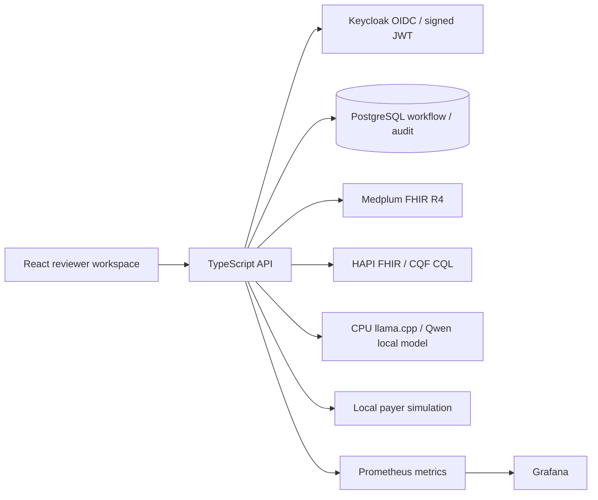

# Architecture and compatibility decisions

This is a synthetic-only, advisory demonstration of JPS RFP #20261404054. It does not implement a production JPS integration or assert HIPAA compliance.

Medplum owns clinical resource versions. Application case bundles are input snapshots, not an alternate clinical system. Review execution refreshes source resources and records their versions. HAPI/CQF runs isolated reasoning with supplied data and `useServerData=false`; no duplicate authoritative patient database is maintained there.

Keycloak authenticates users; the API verifies issuer, audience, signature, expiry and realm roles. Medplum client credentials remain server-side. The demo login uses Keycloak direct access grants and HttpOnly cookies. Production requires Authorization Code + PKCE, TLS, MFA and enterprise SSO configuration.

The model is Qwen2.5-0.5B-Instruct Q4_K_M, Apache-2.0, pinned by upstream revision and SHA-256 (`model-lock.json`). The initial Ollama GPU image exceeded the practical disk budget with Docker's VFS storage driver; a smaller CPU-only llama.cpp image was selected and pinned by digest. The API uses its OpenAI-compatible local endpoint; no hosted model call is made.

Medplum server, SDK and FHIR types are aligned at 5.2.6. HAPI starter v8.6.5-1 exposes its bundled CQF clinical-reasoning operations with `HAPI_FHIR_CR_ENABLED=true`; compatibility is checked by real `$cql` requests. Java dependencies stay within the upstream image rather than being mixed manually. PostgreSQL 16 and Redis 7 follow Medplum's upstream development service recommendations.

Da Vinci PAS is used as a reference for request/response and authorization lifecycle design. This MVP does not implement a PAS-conformant payer endpoint, X12 278 transport, clearinghouse connectivity, CRD or DTR. The PAS repository LICENSE identifies CC0 and links the FHIR license; any future terminology or third-party artifacts need separate review.

Grafana AGPL-3.0 is run unmodified as a separate service. Preserve upstream notices and offer corresponding source if distributing modified versions. This is an engineering license inventory, not legal certification. Transitive npm dependencies are recorded by package-lock.json and audited; containers require separate vulnerability assessment before production.

All Compose published ports bind to loopback. The application and services intentionally use public demo credentials; this configuration must never be exposed to untrusted networks or supplied PHI.
