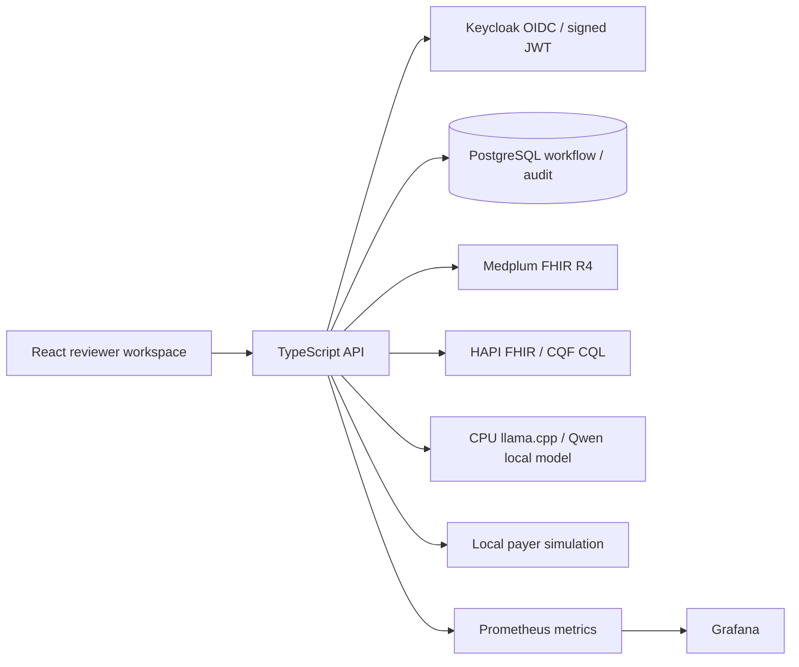

# Architecture and compatibility decisions

This is a synthetic-only, advisory demonstration of JPS RFP #20261404054. It does not implement a production JPS integration or assert HIPAA compliance.

Medplum owns clinical resource versions. Application case bundles are input snapshots, not an alternate clinical system. Review execution refreshes source resources and records their versions. HAPI/CQF runs isolated reasoning with supplied data and `useServerData=false`; no duplicate authoritative patient database is maintained there.

Keycloak authenticates users; the API verifies issuer, audience, signature, expiry and realm roles. Medplum client credentials remain server-side. The demo login uses Keycloak direct access grants and HttpOnly cookies. Production requires Authorization Code + PKCE, TLS, MFA and enterprise SSO configuration.

The model is Qwen2.5-0.5B-Instruct Q4_K_M, Apache-2.0, pinned by upstream revision and SHA-256 (`model-lock.json`). The initial Ollama GPU image exceeded the practical disk budget with Docker's VFS storage driver; a smaller CPU-only llama.cpp image was selected and pinned by digest. The API uses its OpenAI-compatible local endpoint; no hosted model call is made.

Medplum server, SDK and FHIR types are aligned at 5.2.6. HAPI starter v8.6.5-1 exposes its bundled CQF clinical-reasoning operations with `HAPI_FHIR_CR_ENABLED=true`; compatibility is checked by real `$cql` requests. Java dependencies stay within the upstream image rather than being mixed manually. PostgreSQL 16 and Redis 7 follow Medplum's upstream development service recommendations.

Da Vinci PAS is used as a reference for request/response and authorization lifecycle design. This MVP does not implement a PAS-conformant payer endpoint, X12 278 transport, clearinghouse connectivity, CRD or DTR. The PAS repository LICENSE identifies CC0 and links the FHIR license; any future terminology or third-party artifacts need separate review.

Grafana AGPL-3.0 is run unmodified as a separate service. Preserve upstream notices and offer corresponding source if distributing modified versions. This is an engineering license inventory, not legal certification. Transitive npm dependencies are recorded by package-lock.json and audited; containers require separate vulnerability assessment before production.

All Compose published ports bind to loopback. The application and services intentionally use public demo credentials; this configuration must never be exposed to untrusted networks or supplied PHI.

## Review behavior

A fixed synthetic clinical clock (`DEMO_NOW`, default 2026-10-20T12:00:00Z) makes age and deadline scenarios reproducible. Wall-clock event timestamps remain real. UI date refers to the synthetic clock; do not confuse it with production real-time ingestion.

Rules `illustrative-1.0.0` use oxygen saturation <90%, systolic pressure <90 mmHg, expected nights >=2, and observation duration >=24 hours as fabricated teaching examples, not validated medical-necessity or Medicare rules. Observation units, timestamps and required inputs are checked; missing/stale data produces insufficient evidence. A lightweight adapter extracts numeric features from the latest Medplum resources and constructs CQL expressions; HAPI/CQF evaluates these with the source bundle supplied and server data disabled. It does not yet execute authored payer-specific CQL libraries or terminology services.

Local AI chooses urgency, a rationale from existing signals, and source references using grammar-constrained JSON. The response is validated again server-side; unrecognized references/reasons fail closed into a labeled rules-only fallback. Explanations are assembled from verified reason labels rather than accepting free-form clinical assertions from the small model. Urgent/high model classifications add a bounded 10/5 points to the illustrative baseline queue score. Denial signals are not probability estimates. No model accuracy, safety or financial outcome is asserted.

Synthetic observation updates invalidate the prior assessment. Reviews preserve rule version, source resource versions, prompt hash, model output, CQL expressions, demo as-of time, real evaluation time and FHIR Provenance. Optimistic case-change detection prevents an in-flight model result overwriting a newly changed workflow or input snapshot. FHIR and application transactions are separate; reconciliation remains a production requirement.

## Human and payer workflows

Payer actions are user-triggered internal simulation events. Submissions create a synthetic FHIR Claim; responses create a ClaimResponse. They are PAS-inspired examples, not PAS-profile validation or an external authorization API. The simulator supports pending information, approval, partial approval, denial, resubmission and explicit simulated expiration. An event ID and payload hash make retries idempotent and detect conflicting reuse. Notification records are internal events, not messages. All 24-hour deadlines and 48-hour validity windows are fabricated demo settings.

Changing payer context marks triage stale, hides its queue score and requires a fresh assessment before escalation/decision. Synthetic vital updates clear the current assessment and human decision; earlier results remain in audit. Only reviewers/admins can simulate payer actions or escalate. Only advisors/admins can record human decisions on escalated cases. An override requires the explicit clinical-judgment reason, and insufficient evidence permits only a request for more information. Human disposition is recorded in workflow state and never automatically changes the FHIR Encounter.class.

Audit appends are serialized with a database advisory lock and linked using canonical-JSON SHA-256 hashes. A database trigger rejects updates/deletes. `npx tsx scripts/verify-audit.ts` checks the complete chain. A privileged database owner could still disable triggers or rewrite the entire chain; independent immutable storage, separation of database duties and external anchoring are production gaps.
